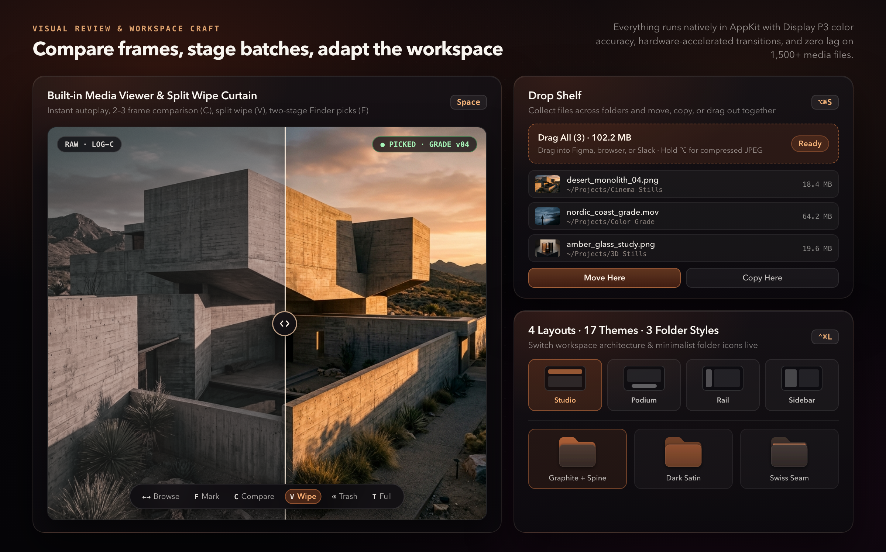

# Qyvro


A native macOS file explorer built for people who work with large volumes of images and video — generative art, editing, color grading, and design.

**Finder** answers *"where does this file live?"*
**Qyvro** answers *"which of these 1,500 frames do I actually need — and what do I do with it next?"*

> **macOS 13+** · **Universal (Apple Silicon & Intel)** · **Pure AppKit** (zero third-party dependencies) · **English & Russian UI** · **MIT License** · **[Download Latest Release (v2.0)](../../releases/latest)** · [Build from source](#build-from-source)

---

## Why Qyvro instead of Finder

Finder was designed for documents. Once a folder holds 1,500 twenty-megabyte stills or ProRes clips, it falls apart: thumbnails stay tiny, resolutions and durations are hidden, and culling a shoot turns into an endless loop of open, close, squint, and drag.

Qyvro is engineered specifically for heavy visual folders — native AppKit, Display P3 color accuracy, hardware-accelerated transitions, and zero lag.

---

## Key Capabilities

### Studio V4 Workspace & Customizable Look

- **4 switchable window layouts (`⌃⌘L`)**: **Studio · Island (V4)** (frameless floating canvas with unified hero header and recessed filter tray), **Podium · Bottom Dock**, **Edge Rail**, and **Classic Sidebar**.
- **17 built-in themes with Deep-Glow + film grain backdrop**: Ships by default in **Aurora · Horizon (V3)** (warm obsidian glass with optical sunset Deep-Glow bloom and organic micro-grain), alongside Studio V4 (*Titanium*, *Noir Amber*, *Malachite*), Aurora & Vision Glass V3, and Classic palettes — with live color swatches in every theme menu.
- **3 minimalist 2-plane folder styles**: *Graphite + Spine*, *Dark Satin*, and *Swiss Seam* — plus custom per-folder colors, Finder tags, and editorial typography (`Avenir Next` + tabular `SF Mono`).
- **Bilingual UI (English / Russian)**: Automatically adapts to your macOS language with instant live switching in Settings (`Auto / English / Русский`).
- **Per-folder view & sort profiles**: Independently remembers thumbnail scale, grid/list mode, and sort order for each folder you customize.

### Visual Grid Built for Media

- **Resolution, duration & file size right under every tile**: `5504×3072 · 18.4 MB`, `3840×2160 · 0:24 · 64.2 MB` — no Get Info window needed.
- **Continuous zoom**: Pinch on the trackpad or `Ctrl + scroll` to smoothly scale from dense rows to full gallery tiles.
- **Date grouping with horizontal carousels**: *Today*, *Yesterday*, *Previous 7 Days*, and monthly groups. Scroll collapsed rows sideways with `Shift + scroll` without expanding the entire section.
- **Version stacking**: Collapses an original, its resized copy, JPEG export, and browser duplicates into a single stack with a count badge. Click to expand.
- **Multi-select floating action bar & Undo toasts**: Batch actions appear right where you work, with non-blocking glass Undo banners (`⌘Z`).

---



### Cull Hundreds of Frames in Minutes

- **Built-in Studio V4 Darkroom viewer (`Space`)**: Color-accurate neutral obsidian lightbox framed by the Aurora Horizon bezel — zero background bleed-through, instant arrow-key browsing, context-aware glass HUD hints, autoplaying video/audio with a floating smoked-glass transport bar, and clickable `A / B` split wipe labels.
- **Grab exact video frame to PNG (`E`)**: Extracts the current video frame at lossless full resolution directly next to the video (`<name>_frame_MM-SS.png`, Display P3 preserved, undoable with `⌘Z`) — or click the camera button on the transport bar.
- **Editorial font preview**: `.ttf`, `.otf`, `.ttc`, and `.dfont` files render live typographic `"Aa"` thumbnail cards in the grid and a full multi-size specimen sheet on `Space`.
- **Side-by-side comparison (`C`)** & **Split Wipe curtain (`V`)**: Compare 2–3 frames next to each other, or overlay two images with an interactive draggable split divider to inspect grades, crops, and upscales.
- **Two-stage native Finder marking (`F`)**: Cycles through *Candidate* (pink corner dot) → *Picked* (green dot) → clear. Stored as real macOS Finder tags inside file extended attributes — survives renames, moves, and Spotlight searches. Also clickable directly on thumbnail corners.
- **Drop Shelf (`⌥⌘S`)**: A floating staging tray to gather files from multiple folders, preview the selection, and move, copy, or batch-drag everything out into Figma, a browser, or another folder (hold `⌥` while dragging to export compressed JPEGs on the fly).

---


### Built-In Pro File Tools

- **Disk Analyzer & SHA-256 Duplicate Finder (`⌥⌘D`)**: Interactive storage ring in the toolbar opens a 3-tab deep scanner — **Folders** (recursive size bars), **Largest Files** (top 150 heaviest files), and **Duplicates (SHA-256)** (3-stage CryptoKit size → prefix → full SHA-256 verification with 1-click safe cleanup that preserves the oldest original).
- **Studio Batch Rename (`⌘⇧R`)**: Dedicated batch-rename window with live *Before → After* preview across 4 modes — **Replace**, **Template** (`{name}`, `{n}`, `{01}`, `{001}`, `{date}`), **Prefix / Suffix**, and **Case / Cleanup** — fully undoable with `⌘Z`.
- **On-the-fly media prep**: Parallelized context-menu resize (`5999 / 4096 / 2560 / 2048 / 1024` + custom), `⌥ + Drag` instant JPEG export (≤5999 px, ≤20 MB) for any drop target, `HEIC → PNG` and `PNG → JPEG` conversion, ZIP/Unzip, SHA-256 checksums, and type-aware *Open in Photoshop / Premiere Pro*.
- **Preview & Inspector Sidebar (`⌥⌘P`)**: Live media specs, auto recursive folder size calculation, Finder tags, and per-folder color swatches.
- **Clipboard History & Cross-Device Cloud Sync (`⌃⌘V`)**: Local history of copied text, links, and images, plus an optional self-hosted sync daemon ([tools/clipsync](tools/clipsync/README.md)) for macOS, Windows, and iPhone over Tailscale Funnel (automatically skips password-manager secrets).

### Navigation & Speed

- **Paste clipboard directly to file (`⌘V`)**: Copy any screenshot, Figma frame, browser image, or text snippet and press `⌘V` inside any folder to save it instantly as `Clipboard_YYYY-MM-DD_HH-mm-ss.png` (or `.txt`), with full `⌘Z` Undo.
- **Browse `.zip` archives as folders (no unzip)**: Press `Enter` or double-click any `.zip` to explore nested folders and preview files with `Space` without extracting gigabytes — then extract just the items you need.
- **Fuzzy Folder Jump (`⌘J`)**: Keyboard-first instant jump across bookmarks, open tabs, recent folders, and nearby subfolders (`Enter` opens here, `⌘Enter` opens in a new tab).
- **Sibling Folder Stepper (`[` / `]` or `⌥←` / `⌥→`)**: Step straight between neighboring folders at the same level via a pinned `‹ 5/22 ›` capsule (with dropdown jumper) next to `⌘J` — completely decoupled from two-finger swipe Back/Forward history.
- **Subtle Git branch badge**: Inside Git repositories, the Studio header quietly displays the active branch and modified file count (`⎇ main · 3`) without cluttering media folders.
- **Silent update checker**: Manually check for newer GitHub Releases from Settings or the App menu — zero background phoning home.
- **Two-finger swipe Back / Forward** with a hardware-accelerated Display P3 wave transition (zero color shift or flash).
- **Command Palette (`⌘K`)**: Keyboard-first launcher (`↑`/`↓`/`Enter`/`Esc`) for actions, layouts, themes, folder styles, and tools.
- **Split Panes (`⌘D`), Tabs (`⌘T`, `⌘1`–`⌘9`, `⌘⇧T`), Bookmarks & Saved Tab Groups**.
- **Folder & Mac Spotlight Search (`⌘F`)** with system-junk filtering.
- **Global Summon (`⌘E`)**: Bring Qyvro above any app from anywhere, press again to hide.

---

## Keyboard Shortcuts

### Explorer

| Shortcut | Action |
|---|---|
| `Space` | Open built-in media viewer |
| `⌘E` | Global summon / hide Qyvro |
| `⌘J` | Fuzzy Jump to Folder (`⌘↵` opens in new tab) |
| `⌘K` | Command Palette |
| `⌥⌘S` | Toggle Drop Shelf |
| `⌥⌘D` | Disk Analyzer & SHA-256 Duplicates |
| `⌥⌘P` | Toggle Preview & Inspector Sidebar |
| `⌃⌘L` | Cycle window layout (Studio / Podium / Rail / Sidebar) |
| `⌘⇧R` | Studio Batch Rename |
| `⌘R` | Refresh current folder |
| `⌃⌘R` | Reveal selection in Finder |
| `⌘D` | Split pane |
| `⌘F` | Focus search (Folder / Mac Spotlight) |
| `⌘Z` / `⌘⇧Z` | Undo / Redo file operations |
| `⌘V` | Paste files — or save clipboard image/text directly as `.png`/`.txt` |
| `⌘⌫` | Move selection to Trash |
| `⌘↑` / `⌘←` / `⌘→` | Parent folder / Back / Forward |
| `[` / `]` or `⌥←` / `⌥→` | Previous / next sibling folder (works in EN & RU layouts) |
| `Shift + scroll` | Scroll collapsed date row horizontally |
| `Ctrl + scroll` / Pinch | Scale thumbnail size continuously |
| `⌥ + drag` | Export ready-to-share JPEG (≤5999 px, ≤20 MB) |
| `⌃⌘V` | Paste from cross-device Cloud Clipboard (when configured) |

### Built-in Viewer

| Key | Action |
|---|---|
| `←` `→` | Previous / next file |
| `F` | Cycle two-stage Finder mark (Candidate → Picked → Clear) |
| `C` | Side-by-side comparison (2–3 frames) |
| `V` | Interactive split wipe curtain |
| `S` / `M` | Play / Pause video & audio · Mute / Unmute |
| `E` | Grab current video frame to lossless PNG |
| `⌫` | Move to Trash and advance to next frame |
| `T` / `Esc` | Toggle fullscreen · Close viewer |

---

## Build from Source

Pure Swift & AppKit compiled directly with `swiftc` — no Xcode project, no SwiftPM, no external dependencies.

```bash
git clone https://github.com/MarkiHaval/qyvro.git
cd qyvro
./build_app.sh
```

**Requirements:** macOS 13+ with Xcode Command Line Tools (`xcode-select --install`).
`build_app.sh` compiles `arm64` and `x86_64` in parallel, merges them into a Universal binary via `lipo`, ad-hoc signs the bundle, and prints the path to the built `Qyvro.app` (drag or copy it into `/Applications`).

### First Launch Note

Because Qyvro is distributed outside the Mac App Store without Apple notarization, macOS Gatekeeper may warn on first launch if downloaded as a prebuilt archive:

1. Right-click `Qyvro.app` → **Open** → click **Open** again.
2. If blocked, go to **System Settings → Privacy & Security** and click **Open Anyway**.

This is only required once.

---

## License

MIT — see [LICENSE](LICENSE).
