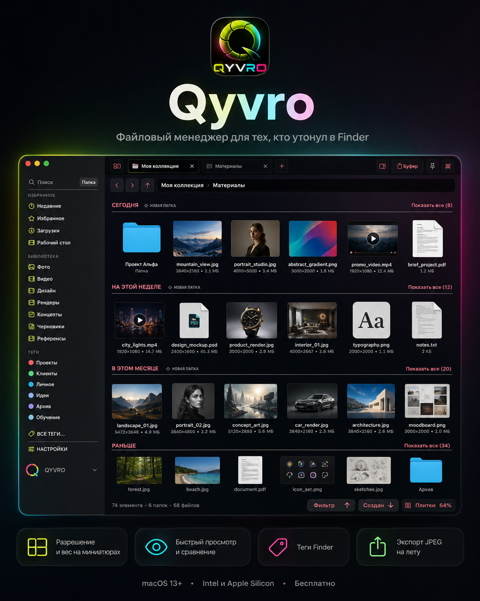
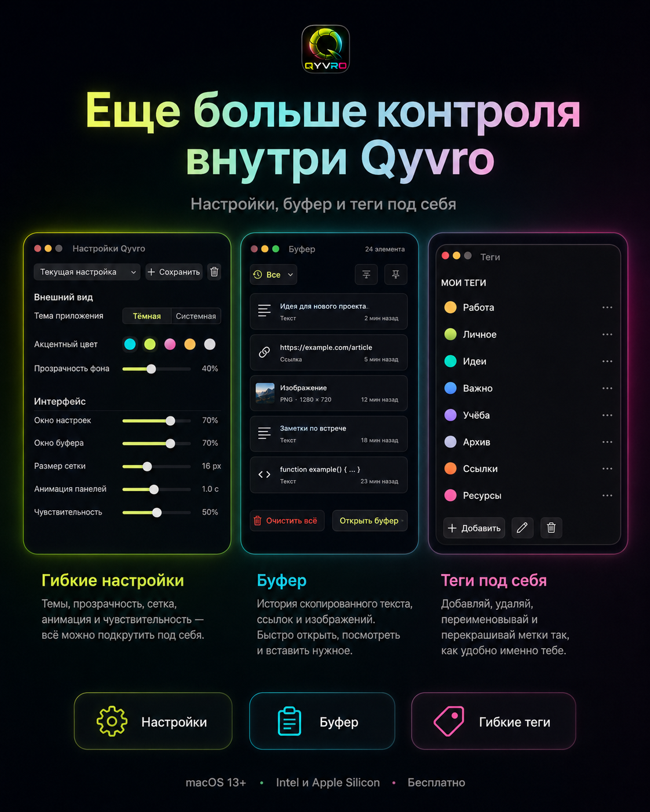

# Qyvro



Файловый менеджер для macOS для тех, кто работает с большими объёмами
изображений и видео: генеративная графика, монтаж, дизайн.

Finder отвечает на вопрос «где лежит файл».
Qyvro отвечает на вопрос «какой из этих полутора тысяч мне нужен и что с
ним делать дальше».

**[Скачать последний релиз](../../releases/latest)** — Universal, Intel и
Apple Silicon, macOS 13+, бесплатно.

---

## Зачем он, если есть Finder

Finder сделан для документов. Когда в папке полторы тысячи картинок по
20 мегабайт, он перестаёт помогать: миниатюры мелкие, разрешения не
видно, нужный кадр ищется глазами, а разбор пачки превращается в
бесконечное «открыл — закрыл — перетащил».

Qyvro сделан ровно для этого случая.

---

## Что он умеет, чего не умеет Finder

### Видно то, что важно

**Разрешение и длительность прямо в плитке.** `5504×3072 · 25 MB`,
`1080×1920 · 0:38 · 51.5 MB`. Не надо открывать свойства, чтобы понять,
подойдёт ли файл. Finder показывает только вес.

**Крупные миниатюры с плавным масштабом.** Щипок двумя пальцами по
трекпаду или Ctrl с колесом мыши меняет размер значков на лету, от
списка до огромных превью.

**Группировка по дням** — «Сегодня», «Вчера», «Предыдущие 7 дней».
Свёрнутый ряд листается вбок: Shift и прокрутка, не раскрывая раздел
целиком.

### Разбор пачки за минуты

**Свой просмотрщик вместо Quick Look.** Пробел открывает окно, стрелки
листают, и прямо оттуда:

- `F` — отметить файл (нажатие перебирает две ступени)
- `⌫` — в корзину, с переходом к следующему кадру
- `C` — сравнение двух-трёх кадров рядом
- `V` — шторка: два кадра наложены друг на друга, между ними подвижная
  граница
- `S` — пауза/воспроизведение для видео и музыки
- `M` — звук вкл/выкл
- `T` — во весь экран

Видео и музыка воспроизводятся сразу при открытии, без клика по play.
Громкость и звук/без звука запоминаются между открытиями.

**Две ступени отметки.** Нажатие перебирает состояния по кругу:
«кандидат» — розовая точка в углу кадра, «точно берём» — салатовая,
третье нажатие снимает. Не два значка, а один, сменивший цвет: так
читается быстрее и не засоряет миниатюру.

Отметки — настоящие метки macOS: они живут в самом файле, переживают
переименование и перемещение, видны в Finder и находятся поиском.

**Отметка мышью.** Точка в углу миниатюры: у отмеченных горит всегда, у
остальных проявляется под курсором.

### Подготовка файлов без сторонних программ

**Ресайз в контекстном меню.** Пресеты 5999 / 4096 / 2560 / 2048 / 1024
и свой размер. Пропорции сохраняются, оригинал не трогается, результат
ложится рядом.

**Перетаскивание с ⌥.** Обычное перетаскивание отдаёт оригинал, с
зажатым ⌥ — готовый JPEG не длиннее 5999 точек и не тяжелее 20 мегабайт.
Файл готовится на лету, поэтому работает с любым получателем: браузером,
Figma, мессенджером.

**Конвертация** HEIC → PNG и PNG → JPEG, упаковка в ZIP, распаковка,
SHA-256, пакетное переименование.

**Открыть в Photoshop и Premiere Pro** — отдельными пунктами меню, с
разделением по типам: видео не предлагается открыть в Photoshop.

### Порядок в папке на полторы тысячи файлов

**Фильтры** рядом с сортировкой: только картинки, только видео,
отмеченные, «точно берём», отмечено сегодня, сегодня, вчера, за 7 дней,
больше 20 МБ.

**Схлопывание версий.** Оригинал, уменьшенная копия, её JPEG-вариант и
дубль от браузера показываются одной стопкой со счётчиком. Нажатие
раскрывает.

**Занятость диска** внизу боковой панели: кольцо со свободным местом,
раскрывается в разбивку по типам с процентами.

### Навигация

**Жест назад-вперёд** двумя пальцами с волновой анимацией перехода.

**Вкладки и панели** — несколько папок в одном окне, разделённые панели
для перетаскивания между ними.

**Буфер обмена** с историей скопированного.

**Поиск** по текущей папке или по всему компьютеру через Spotlight, с
отсевом системного мусора.

**Цветные метки** и цвета папок, закреплённые папки, сохранённые группы
вкладок.

### Внешний вид

Девять встроенных тем на почти чёрной основе, каждая с одной яркой парой
цветов. Настраивается всё: цвета окна, панелей, акцентов, прозрачность,
плотность сетки, чувствительность жестов.

---

## Горячие клавиши

| | |
|---|---|
| Пробел | Просмотр выделенного |
| ⌘E | Показать проводник поверх остальных окон, повторно — спрятать |
| ⌘R | Показать в Finder |
| ⌘⇧R | Пакетное переименование |
| Shift + прокрутка | Листать свёрнутый ряд вбок |
| Ctrl + колесо | Размер значков |
| ⌥ + перетаскивание | Отдать подготовленный JPEG |

В просмотрщике: `←` `→` листать, `F` отметить, `⌫` в корзину,
`C` сравнение, `V` шторка, `S` пауза/воспроизведение, `M` звук,
`T` во весь экран, `Esc` закрыть.

---



## Первый запуск

Приложение подписано лично автором — не через App Store и без
нотаризации Apple, поэтому при первом запуске macOS покажет
предупреждение. Это не баг:

Правый клик по `Qyvro.app` → **Открыть** → в диалоге ещё раз
**Открыть**. Если такого пункта нет — Настройки → «Конфиденциальность и
безопасность» → внизу страницы кнопка **«Открыть всё равно»**.

Это нужно один раз.

---

## Сборка из исходников

Чистый AppKit на голом `swiftc` — нет ни Xcode-проекта, ни SwiftPM.

```bash
git clone https://github.com/MarkiHaval/qyvro.git
cd qyvro
./build_app.sh
```

Требуется macOS с установленными Command Line Tools. Скрипт собирает
Intel и Apple Silicon параллельно, склеивает `lipo`, подписывает ad-hoc
и печатает путь к готовому `Qyvro.app`. Подробности — в `CLAUDE.md`.

---

## Лицензия

MIT — см. [LICENSE](LICENSE).
